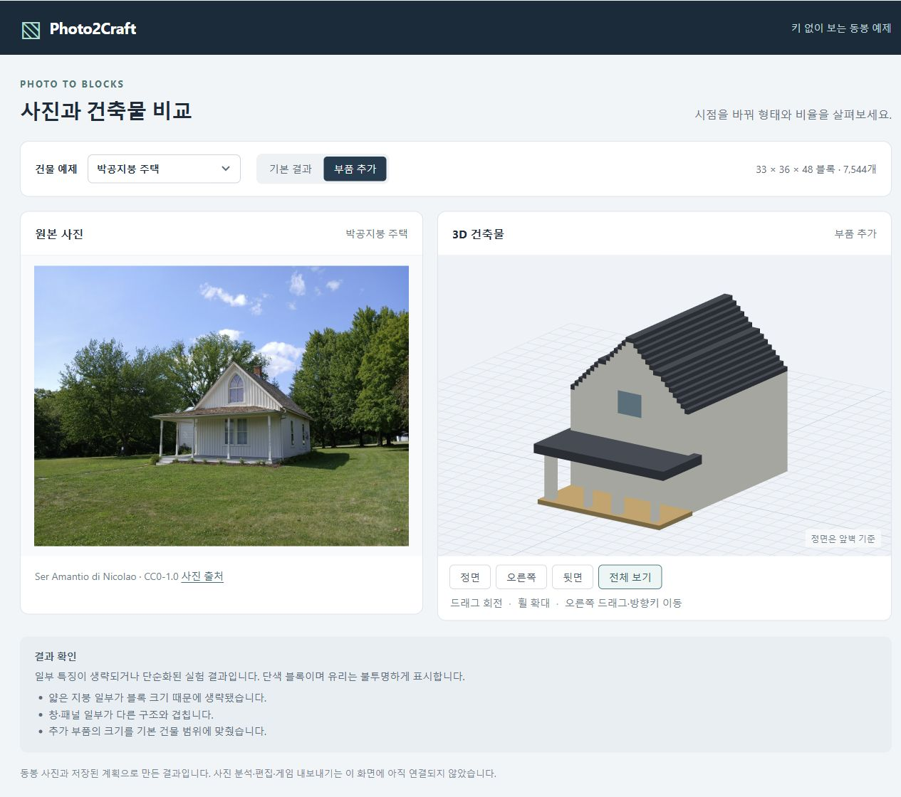

# Photo2Craft

건물 사진의 특징을 마인크래프트 블록 건축물로 옮기는 개인 텀프로젝트.
현재는 저장된 건축 계획을 블록으로 변환하고 로컬 웹에서 확인할 수 있다. 새 생성 경로는 TRELLIS.2의 메시를 사용하며, 지금까지 고딕 주택과 슈뢰더 주택에서 메시 생성과 별도 블록 변환을 실험했다. 웹에는 아직 연결 전이다.

## 새 개발 방향

1. 사진을 TRELLIS.2에 보내 기본 배경 제거와 1024 해상도 메시 생성을 맡긴다. GLB에서 지붕·측면·돌출부의 위치를 읽고, Clay 미리보기로 윤곽과 얇은 부위를 비교한다.
2. Photo2Craft가 메시를 정수 블록 좌표로 변환하고, 바닥 높이와 건물 크기를 정한다. 가장 긴 변은 48블록에서 시작해 주요 특징이 뭉개지면 더 큰 후보를 비교한다. 반블록·울타리와 사진 기반 재질은 기본 변환 결과를 확인한 뒤 적용한다.
3. 공통 블록 데이터를 웹 미리보기와 Minecraft Java 구조물 파일에 쓴다. 웹 편집은 제한된 재질 수정부터 검토한다.

다음 작업은 저장된 GLB 하나를 키 없이 블록으로 변환해 웹에서 여는 것이다. 이후 기본 블록 결과를 실제 Java Edition에 가져와 확인한다. 메시·블록 비교에서 확인한 결과는 [실험 기록](EXPERIMENTS.md#2026-11-25-trellis2-메시-실험)에 정리했다.

## 기존 계획 기반 데모

| 사진 | 입력과 생성 결과 | 확인한 한계 |
|---|---|---|
| 박공지붕 주택 | [비교 이미지](examples/gothic/run-04/comparison.png) | 현관 기둥·굴뚝·옆면 창 누락, 현관 지붕 높이 오류 |
| 비대칭 평지붕 건물 | [비교 이미지](examples/schroder/replay-01/comparison.png) | 상자 형태로 단순화, 면의 후퇴·돌출과 창 비율 오류, 빨간 부재 매몰 |

동봉된 결과는 Gemini의 건축 계획을 변환한 것이다. 두 사진의 지붕과 일부 특징을 구분했으나 창 배치, 측면, 현관 비율의 오차가 컸다. [기존 실험 기록](EXPERIMENTS.md)

## 실행 준비 (Windows / Python 3.12)

```powershell
py -3.12 -m venv .venv
.\.venv\Scripts\python.exe -m pip install -e ".[dev]"
.\.venv\Scripts\python.exe -m pytest -q
```

## 웹 3D 확인

저장소 루트에서 실행하고 터미널에 표시된 [로컬 주소](http://127.0.0.1:8000)를 브라우저로 연다.

```powershell
.\.venv\Scripts\python.exe -m photo2craft.cli serve
# 포트 변경: --port 8001
# 다른 위치에서 실행할 경우: --examples C:\dev\Photo2Craft\examples
```



- 박공지붕 주택의 기본/부품 추가 결과와 비대칭 평지붕 건물을 선택한다.
- 왼쪽 드래그로 회전, 휠로 확대, 오른쪽 드래그 또는 모델에 초점을 둔 방향키로 이동한다. 정면·오른쪽·뒷면·전체 보기 버튼으로 시점을 되돌린다.
- 사진·계획·Three.js가 동봉되어 실행 중 API 키·인터넷·Node.js가 필요 없다. Python 패키지 최초 설치에는 인터넷이 필요하다. WebGL2와 JavaScript를 지원하는 브라우저를 사용한다.
- 서버는 `127.0.0.1`에서만 실행되며 종료는 `Ctrl+C`다. 저장된 예제를 읽어 보여주는 화면으로, 새 사진 업로드·분석·편집·게임 내보내기는 아직 연결하지 않았다.
- CLI와 웹은 같은 `pipeline.compile_document()`로 블록을 계산한다. 단색·불투명 유리 표현이며 사진 유사도나 실제 게임 호환성을 보장하지 않는다.

브라우저 조작·데이터 일치 확인은 [검증 기록](docs/validation/viewer-20261123.md)에 정리했다.

## CLI에서 예제 재생성

설치가 끝나면 아래 명령은 **API 키와 네트워크 없이** 동봉 결과를 다시 생성한다.

```powershell
.\.venv\Scripts\python.exe -m photo2craft.cli build examples\gothic\run-04\plan.json --photo examples\gothic\run-04\input.jpg --out outputs\gothic-demo
.\.venv\Scripts\python.exe -m photo2craft.cli build examples\schroder\replay-01\plan.json --photo examples\schroder\run-01\input.jpg --out outputs\schroder-demo
.\.venv\Scripts\python.exe -m photo2craft.cli build examples\frozen-baseline-20261123\run\plan.json --photo examples\gothic\run-04\input.jpg --out outputs\frozen-demo
```

출력 폴더의 `comparison.png`를 열어 사진/입력 쪽 시점/정면/반대쪽을 확인한다. `blocks.json`은 좌표·팔레트·생성 부품 ID를 담는 자체 형식으로, 게임 파일 형식은 아직 아니다. `summary.json`은 구조 경고, `build.json`은 입력·소스 해시와 실행 의존성을 담는다.

Gemini `analyze`, `replay`, `attach` 명령의 사용법은 [이전 실행 문서](https://github.com/twy1207/Photo2Craft/blob/9b7344208d115e87ed55b07550dbed95ea55284f/README.md)에서 볼 수 있다. 부품 추가 사례의 결과와 재현 방법은 [고정한 기본 형태 비교](examples/frozen-baseline-20261123/REVIEW.md)에 남겼다.

작업 지침은 [AGENTS.md](AGENTS.md), 자료·사진·라이선스는 [REFERENCES.md](REFERENCES.md)를 참고한다. 초기 프로토타입은 `codex/prototype-v0`에 보존되어 있다.
