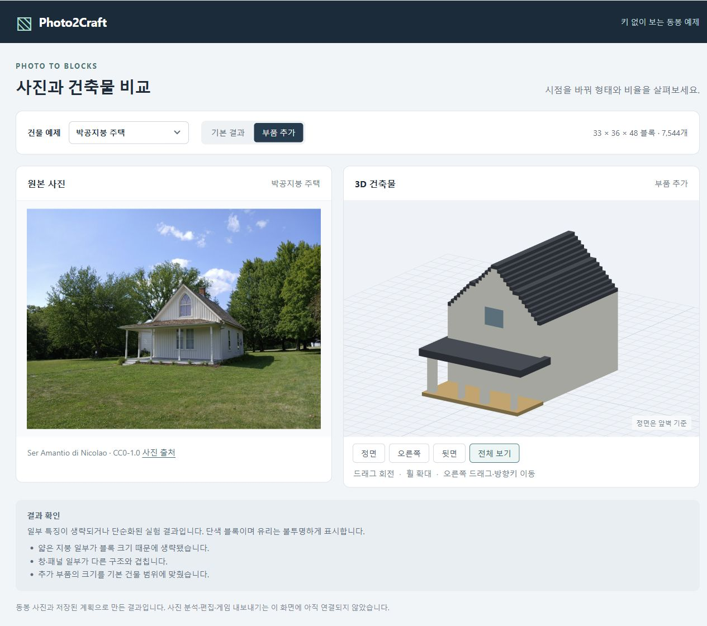

# 로컬 웹 3D 확인

2026-11-23. 현재 생성 결과를 읽어 보여주는 최소 뷰어를 구현했다. 생성 방식·AI 프롬프트는 변경하지 않았고 새 AI API 호출도 하지 않았다. 웹 편집·새 사진 입력·게임 출력은 이번 범위에 없다.



## 확인한 내용

- API 키 두 환경 변수를 제거한 프로세스에서 `serve` 실행.
- 기본 주택 7,052개, 부품 추가 주택 7,544개, 평지붕 건물 15,342개 블록 확인. 세 API의 `scene` 전체를 이전 CLI의 `blocks.json`과 비교해 일치 확인(좌표·재료·부품 ID·경고 포함).
- 브라우저에서 사진과 3D를 나란히 표시하고 건물 선택, 기본/부품 추가 전환 확인.
- 정면·오른쪽·뒷면·전체 보기 버튼의 전환, 마우스 드래그 회전, 휠 확대, 방향키 이동 확인. 오른쪽 드래그 이동은 OrbitControls의 기본 동작으로 제공하며 이번 조작 검증의 이동 입력은 방향키로 수행했다.
- 1280px 데스크톱 뷰포트에서 두 열 배치, 390px 좁은 뷰포트에서 세로 배치와 가로 넘침 없음 확인. 좁은 화면은 브라우저 크기 변경으로 확인했으며 실물 모바일 기기 테스트는 아니다.
- Three.js 카메라와 데이터의 좌표계 차이로 좌우가 반전된 초기 표시를 발견했다. 표시할 때 z 부호를 변환하고 정면 카메라 방향을 맞춰 기존 PNG와 같은 앞/옆 관계가 보이도록 보정했다. 서버의 블록 좌표는 변경하지 않았다.
- 브라우저 콘솔 오류·경고 없음. 단색·불투명 유리, 조명·투영 차이 때문에 PNG와 픽셀 단위 일치는 비교하지 않았다.
- 없는 예제와 웹 자산 밖 경로 요청의 404 응답 확인. 웹 루트와 고정된 예제 목록만 제공하고 원본 저장소 전체를 정적 파일로 공개하지 않는다.
- 기존 테스트 7개 통과, 프런트엔드 JavaScript 구문 검사 통과. 이번 화면을 위한 구현과 같은 형태의 자동 테스트는 추가하지 않았다.
- 공통 계산 경로 추출 후 CLI로 부품 추가 예제를 다시 생성해 이전 블록 JSON·PNG와 일치 확인.
- 별도 작업 폴더에서 wheel을 빌드해 서버·공통 계산 모듈·웹 파일·Three.js 배포본·라이선스가 원본 바이트 그대로 포함되는지 확인. 새 Python 의존성 없음.
- 라이브러리 원본 파일 해시, 로컬 문서 링크와 비밀정보 패턴 검사 통과.

## 실행

저장소 루트에서:

```powershell
.\.venv\Scripts\python.exe -m photo2craft.cli serve
```

`http://127.0.0.1:8000`에 접속한다. 종료는 `Ctrl+C`, 포트 변경은 `--port 8001`, 예제 루트 지정은 `--examples <경로>`다. 검증용 서버와 브라우저 탭은 검증 후 종료했다.

## 구현 범위

`pipeline.py`는 CLI와 웹의 공통 블록 계산 경로다. `server.py`는 시작할 때 동봉 계획을 계산해 메모리에 보관하고 읽기 전용 API로 제공한다. 브라우저는 같은 좌표·재료를 InstancedMesh로 표시하며 마우스 조작 시 시점만 바꾼다. 생성 계획·블록 파일을 수정하거나 API 키를 다루지 않는다.

Three.js 배포본의 필요한 파일과 MIT 라이선스를 동봉해 초기 Python 설치 후 뷰어 실행에 외부 CDN이나 Node.js가 필요 없게 했다. 외부 자료는 [출처 기록](../../REFERENCES.md)을 참고한다.
