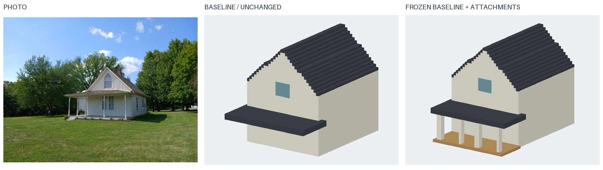

# 고딕 주택 부품 추가

저장된 고딕 계획의 본체와 지붕을 고정하고, 새 제안으로 현관 바닥과 기둥을 추가했다. 바닥이 기존 외곽을 넘은 첫 결과는 거절됐고, 단순 상자의 범위를 잘라 맞춘 뒤 같은 입력으로 다시 계산했다.



기본 **7,052블록의 좌표와 재질**이 모두 유지됐고 **492블록**이 추가됐다. 현관 바닥과 기둥이 생겼으며, 기둥 굵기·배치와 기존 창 비율은 사진과 차이가 남았다. [검증값](invariants.json) · [공간 보정 결과](run/spatial-resolution.json)

## 키 없이 재현

저장소 루트에서 실행한다.

```powershell
.\.venv\Scripts\python.exe -m photo2craft.cli build examples\frozen-baseline-20261123\run\plan.json --photo examples\gothic\run-04\input.jpg --out outputs\frozen-demo
```

원본 제안은 [응답](run/response.json)에 있다. 당시 요청·초기 실패와 보정 과정은 [과거 실험 기록](https://github.com/twy1207/Photo2Craft/blob/2760722cdd59c4be2fe0a3cd1a469eb73f9bb2ec/examples/frozen-baseline-20261123/REVIEW.md)에서 확인할 수 있다.
