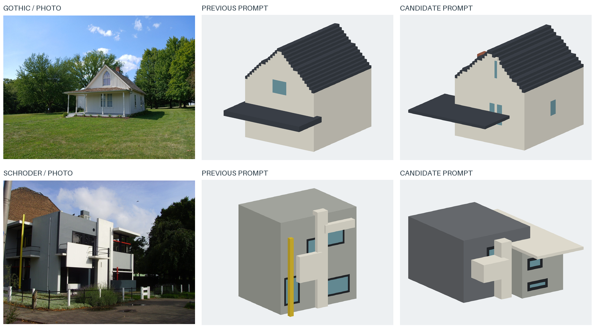

# 프롬프트 개선 비교

## 실행 전 정한 범위

프롬프트만 변경한다. 모델은 기존 결과를 얻은 `gemini-3.5-flash-lite`, 사진·전처리·요구사항·API 출력 스키마·생성 설정·변환기·출력 크기는 유지한다. 기존 Gothic `run-04`, Schröder `run-01` 응답 및 `replay-01` 출력과 비교한다. 두 입력은 개발 중 본 사진이므로 일반화 성능 검증은 아니다.

수정 가설: 대상/배경 구분 → 구조 관찰 → 부품 생성 → 누락·부착 확인의 순서와 좌표 기준을 명확히 하면 누락·매몰이 줄 수 있다. 여러 지침을 함께 수정하므로 효과가 나더라도 특정 문장 하나의 효과라고 주장하지 않는다. 기존 성공 요청 이후 추가된 평지붕 높이 0 설명도 이번 프롬프트에 포함된다.

## 비교 기준 (새 결과를 보기 전에 고정)

- 대상 선택: 인접 건물·나무·울타리 등이 결과에 섞였는가. 기존 결과에서도 큰 배경 혼입은 확인되지 않았으므로 유지 여부를 본다.
- Gothic: 가파른 박공과 본체 비율, 박공 창의 높이, 현관 지붕·바닥·기둥의 존재와 접합, 보이는 옆면 창·굴뚝의 반영.
- Schröder: 단일 상자로의 단순화 정도, 흰 판/발코니/지붕의 돌출·후퇴, 창의 배열과 비율, 노랑·빨강 부재의 존재와 외부 가시성.
- 악화 여부: 주요 특징의 새 누락, 원본에 없는 큰 부품, 잘못된 참조·출력 검증 실패, 분리·겹침을 함께 기록한다. 부품 수 증가나 구조 경고 감소만으로 성공이라 하지 않는다.

각 사진 1회 생성한다. 실패 시 원인을 기록하며 원본 응답이나 계획을 사진별로 수작업 수정하지 않는다. 필요 이상의 반복 생성·자동 테스트는 하지 않는다. 한 번씩의 전후 비교는 탐색 결과이며 통계적 개선 증명은 아니다. 프롬프트의 자체 확인 문구도 코드 검사나 실제 마스크 분리를 구현한 것은 아니다.

## 결과

두 요청 모두 로컬 계획 검증과 블록 생성에 성공했다. 아래 평가는 생성 전 정한 항목과 사진·동일 시점 렌더를 사람이 비교한 결과이며 정량 유사도 점수가 아니다.

| 항목 | 기존 → 후보 | 판단 |
|---|---|---|
| 대상/배경 | 두 버전 모두 큰 배경 혼입 없음 | 유지. 추가 지침의 효과는 입증되지 않음 |
| Gothic 주요 부품 | 없던 굴뚝·오른쪽 창이 생김. 현관 기둥·바닥은 여전히 없음 | 일부 추가, 누락 문제 미해결 |
| Gothic 비율·배치 | 박공 창이 처마 위로 이동했지만 중앙에서 벗어나고 유리 영역이 가느다란 선으로 보임. 현관 지붕은 계속 낮으며 왼쪽으로 치우침. 굴뚝 위치도 원본과 다름 | 명확한 전체 개선 없음 |
| Gothic 면 방향 | `front_right` → `front_left`지만 실제 사진은 앞면과 오른쪽 면이 보임. 오른쪽 창은 계획에 있으나 후보의 기본 비교 시점에서는 보이지 않음 | 방향 판단 악화. 종합 이미지는 양쪽 모두 동일 yaw=35로 렌더 |
| Schröder 큰 형태 | 하나의 본체에서 본체+오른쪽 덩어리로 분리됨 | 덩어리 분해는 변화했으나 실제 비율·높이·면 배치가 개선됐다고 보기 어려움 |
| Schröder 주요 부품 | 노란 기둥이 사라짐. 빨간 부재도 계획에서 빠짐 | 악화. 매몰을 해결한 것이 아님 |
| 관찰과 계획 일치 | Gothic 기둥과 Schröder 노란 기둥은 관찰에 계속 있지만 실제 부품은 없음 | 자체 확인 지침만으로 누락을 방지하지 못함 |
| 관찰/추정·근사 | 두 건물 모두 `approximate`; 주택 아치·현관 지붕의 근사를 설명함 | 한계 표현은 구체화됨. 자동으로 사실 검증된 것은 아님 |

Gothic은 6,027블록, Schröder는 7,892블록이다. 부품 수나 블록 수는 유사도 개선 지표로 쓰지 않았다. 후보의 `assumptions`에는 실제 계획에 없는 후면 확장이나 내부 배치에 대한 서술도 남아 있으므로, 설명 문구와 구현된 구조를 같은 것으로 취급해서는 안 된다.

## 조건과 검증

- 각 폴더의 `conditions.json`에서 모델·전송 사진 해시·생성 설정·요구사항이 기준과 동일하고 프롬프트 해시만 다름을 확인했다. 변환기·데이터 모델·렌더러 코드는 바꾸지 않았다.
- 원본 응답·검증된 계획을 그대로 보존했다. 사진별 JSON 수정이나 좋은 결과를 고르는 재생성은 하지 않았다. 전체 비교 PNG와 고정 시점의 전후 이미지도 보존했다.
- API 키를 제거한 프로세스에서 두 후보 계획을 다시 빌드하여 최초 블록 JSON·비교 PNG와 일치하는지 확인했다. 코드 변경이 없어 자동 테스트를 추가하거나 반복 실행하지 않았다.
- API 메타데이터상 각 요청의 입력은 2,234토큰으로 기존 2,096보다 138 증가했다. 출력은 Gothic 1,168, Schröder 1,400토큰이며 이번 두 요청의 합계는 7,036토큰이다. 실제 과금은 확인하지 않았다.
- 두 사진에 한 번씩만 요청한 결과다. 무작위 생성 편차와 프롬프트 효과를 분리하지 못하며, 처음 보는 사진에 대한 개선 근거도 없다.

## 적용 판단

후보 문구는 [candidate-prompt.txt](candidate-prompt.txt)에 보존하고 **기본 프롬프트 교체는 보류**한다. 전체 품질 개선이 명확하지 않고 노란 기둥 누락 같은 악화가 있어, 실행에 사용되는 `photo2craft/prompt.txt`는 이번 작업 전 내용으로 돌려놓았다. 후보를 성공한 개선으로 표시하지 않는다.

다음 후보는 지침을 더 쌓는 대신 주요 관찰 특징과 계획 부품의 연결을 구조화해 코드에서 누락을 검사하는 것이다. 비율·부착 오류는 별도 문제로 남는다. 이 문서는 프롬프트 비교 결과만 기록하며 후속 구현을 승인받았다는 뜻은 아니다.
