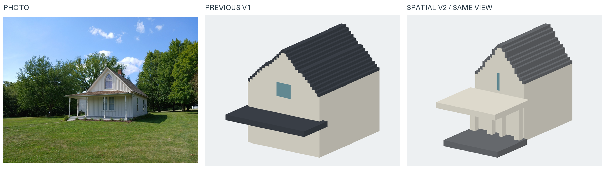

# 공간 관계 생성 실험

## 실행 전에 정한 범위

기존 계획(v1)을 유지하면서 실험용 공간 계획(v2)을 추가한다. AI는 부착 면·중심 앵커·상대 치수와 높이 관계를 반환하고, Python 코드가 좌표와 지지 부품 길이를 계산한다. 기존 블록 생성기와 단색 렌더러를 사용한다. 이번 작업은 공간 관계 계획부터 첫 블록 출력까지이며 AI의 결과 재수정 루프는 포함하지 않는다.

- 수작업 예제: 본체 앞 바닥·윗면이 처마와 같은 캐노피·그 사이를 연결하는 두 기둥. 사진에서 생성된 결과로 취급하지 않는다.
- 핵심 검사: 크기 변경·입력 순서 변경 후에도 기둥이 바닥과 지붕에 접하는가, 중앙의 열린 공간이 남는가. 잘못된 참조/순환/지지면이 겹치지 않는 관계는 거절하고 열린 영역의 방해물은 경고한다.
- 사진: 기존 Gothic 사진 한 장에 Gemini 3.5 Flash Lite를 1회 요청한다. 프롬프트와 계획 형식이 함께 바뀌므로 프롬프트만의 효과나 모델 간 성능 차이로 해석하지 않는다.
- 사진 판단: AI 계획에 현관 바닥·기둥·지붕이 있는가, 관계가 의미상 맞는가, 실제 블록에서 연결·열린 공간·창 높이가 맞는가, 이전보다 새 오류가 생겼는가. 구조적으로 연결됐다는 사실만으로 사진 유사도가 개선됐다고 하지 않는다.
- 자동 테스트는 기존 3개와 신규 관계 핵심 동작 3개로 제한한다. 커밋은 별도 승인 후에만 한다.

## 결과



## 확인 결과

| 구분 | 확인한 내용 | 한계 |
|---|---|---|
| 수작업 예제 | 본체 높이와 전체 해상도를 바꿔도 기둥의 하단/상단이 바닥/캐노피에 접함. 부품 순서를 뒤집어도 결과 같음. 중앙 빈 공간 유지. 순환·잘못된 지지 관계는 거절하고 열린 공간 방해물은 경고함 | 사진 분석이나 물리적 구조 안전 검증이 아님 |
| AI 공간 계획 | 현관 바닥·지붕·기둥 4개를 작성. 각 기둥은 바닥 윗면에 부착되고 바닥과 지붕 사이 길이를 코드가 계산하도록 `between` 사용 | 현관이 지나치게 깊고 기둥이 바닥 뒤쪽(`anchor` 두 번째 값 0.9)에 몰림. 본체 높이/폭=1, 깊이/폭=1.4로 잡아 전체 비율이 부정확. 지붕은 `align_top` 대신 낮은 면 앵커 사용 |
| 블록 결과 | 이전에 빠졌던 바닥·기둥이 생김. 네 기둥의 끝이 실제 점유 블록 기준으로 바닥·지붕에 접하고 선언된 열린 공간에 다른 매스가 없었음. 5,536블록, 구조 경고 0개 | 현관 깊이·기둥 위치·지붕 높이는 사진과 다름. 굴뚝 누락, 박공 창 높이·너비와 하부 창 배치 오류 지속. 공간 연결 성공을 전체 유사도 개선으로 판단하지 않음 |

`view=front_left`, 옆면 창도 `face=left`로 판단했으나 사진은 앞면+오른쪽 면으로 보는 것이 자연스럽다. 정면 선택과 면 해석의 오류가 남았다. 원본 응답은 `supported`라 했지만 경사진 현관 지붕·아치 창을 단순화했으므로 모델의 자기평가를 지원 보장으로 사용하지 않는다.

종합 비교 이미지는 이전 v1과 v2를 동일 yaw=35, elevation=18로 렌더했다. 각 실행의 `comparison.png`는 모델이 선택한 방향도 그대로 보존한다. AI 계획을 사진별로 손수 고치지 않았으며 반복 요청도 하지 않았다.

## 구현 경계

- `attachment`는 호스트의 면과 그 면의 중심 앵커다. 앞·뒤 면의 두 값은 x/y, 좌·우 면은 z/y, 윗면은 x/z다. 기존 창 패치의 u/v는 여전히 왼쪽 아래 기준이므로 서로 다르다.
- 치수는 얇은 호스트 부품의 크기와 관계없이 모두 본체 치수의 비율이다. `face`는 면에 접촉, `on_top`은 지정 부품 위, `align_top`은 윗면 높이 일치, `between`은 아래 윗면~위 부품 아랫면 사이 길이 계산이다. 지붕 꼭대기가 아닌 상자 경계 기준이다.
- 해석한 좌표는 `resolved-plan.json`, 관계·빈 영역은 `spatial-resolution.json`에 기록한다. 기존 v1 블록 생성기로 이어지며 자동 재생성/AI 피드백 루프는 없다.
- 열린 공간 검사는 바닥·캐노피의 겹치는 바닥면적 사이를 검사한다. 허용한 기둥은 제외하고 다른 부품의 상자가 겹치면 경고한다. 임의 형상 공극 분석·자동 절삭·내부 구조 복원·실제 하중 계산은 아니다. 서로 다른 부품이 겹쳐 덮어쓰이는 문제도 모두 해결하지 않았다.
- 전체 비율·기둥의 수와 가로 위치·창 배치·관찰 누락은 여전히 AI 판단이다. 관계 해석기가 강제로 사진을 닮게 만드는 것은 아니다.

## 재현과 검증

```powershell
# 수작업 관계 예제: API 없이 실행
.\.venv\Scripts\python.exe -m photo2craft.cli build examples\spatial-20261123\synthetic-plan.json --out outputs\spatial-synthetic-demo
# 실제 AI 응답에서 다시 계획을 읽어 생성: API 없이 실행
.\.venv\Scripts\python.exe -m photo2craft.cli replay examples\spatial-20261123\gothic\response.json --photo examples\gothic\run-04\input.jpg --out outputs\spatial-photo-demo
```

초기 실험에서 사용한 `--spatial` API 옵션과 프로그램 안의 전용 프롬프트는 정리 단계에서 제거했다. 실제 전송 프롬프트는 `gothic/prompt.txt`, 요청 설정은 `gothic/request.json`에 보존한다. 저장 응답의 재생성과 부품 추가에 쓰는 관계 계산 코드는 유지한다. 기본 분석 형식은 v1이다. 사진은 [기존 출처](../gothic/source.json)의 축소본과 동일하며 전송 이미지 해시를 `gothic/input-reference.json`에 기록했다. 패키지나 외부 코드는 새로 도입하지 않았다.

`resolved-plan.json`은 위 명령으로 출력 폴더에 다시 만들 수 있어 동봉본에서 제외했다. 원본 계획·응답·비교 이미지·관계 기록은 남겼다.

- 기존 3개 + 신규 공간 관계 검사 3개, 총 6개 통과.
- API 키를 제거한 프로세스에서 저장된 v2 응답을 재검증·생성하여 블록 JSON/비교 이미지/관계 기록 일치 확인. 기존 v1 주택도 재생성하여 원래 비교 이미지와 일치 확인.
- 수작업/실제 사진 렌더를 직접 확인. API 요청 1회, 입력 2,432·출력 2,201·합계 4,633토큰. 실제 과금 내역은 미확인.
- 새 사진 일반화·다른 모델과의 비교·웹 편집·게임 출력은 이번에 확인하지 않았다.

## 다음 판단

관계를 코드가 계산하는 경로는 동작했다. 이후에는 이 표현을 바로 전체 설계로 확정하기보다 본체 비율·면 방향·현관 깊이·기둥의 앞뒤 위치 오류를 줄일 방법을 검토해야 한다. 새 건물 적용과 생성 결과를 AI가 다시 고치는 단계는 아직 진행하지 않았다.
